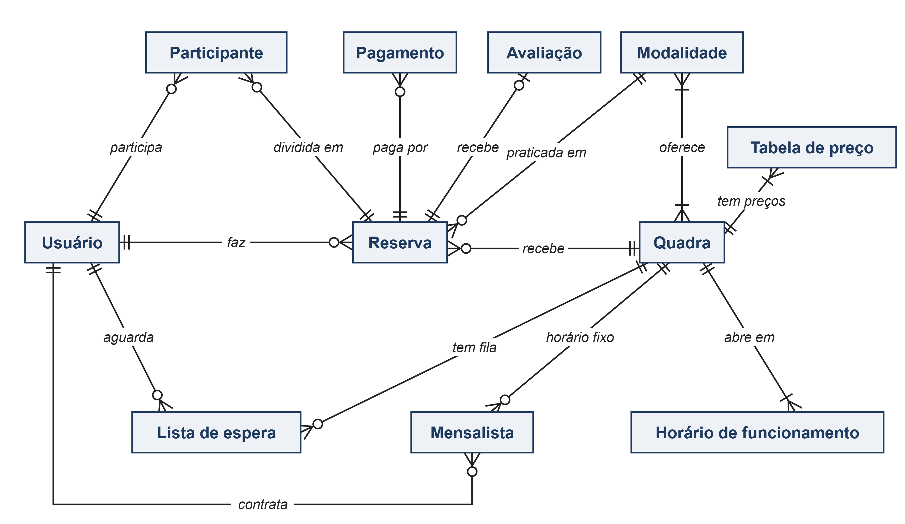
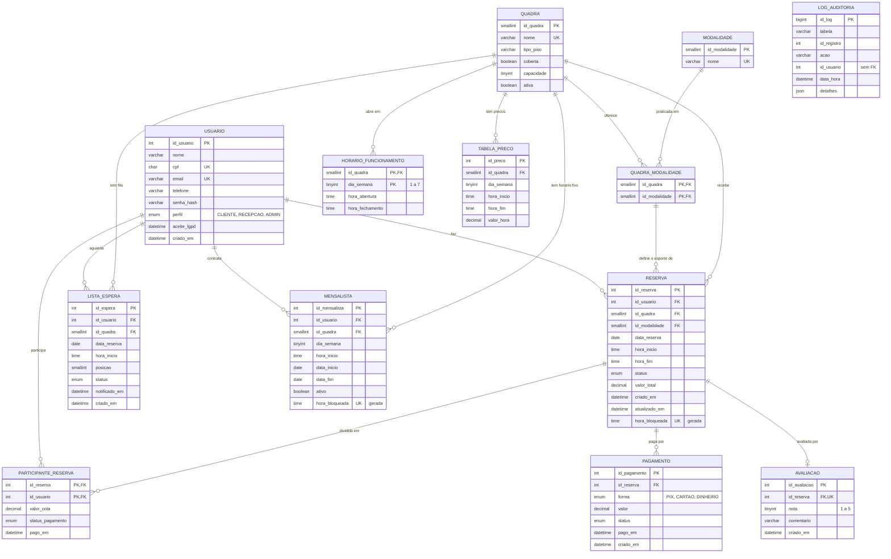

# Banco de dados do JOGGA

Este documento cobre a **Etapa 4 do PIM II** (Modelagem de Banco de Dados e NoSQL): modelo conceitual, DER, modelo lógico, normalização, modelo físico, dicionário de dados e uso de NoSQL. Os scripts estão em [`banco/`](../banco) e foram executados e testados no **MySQL 8.4 LTS** (InnoDB, utf8mb4).

| Script | Conteúdo |
|---|---|
| [`01_criacao.sql`](../banco/01_criacao.sql) | `CREATE DATABASE`, 13 tabelas, PK/FK, `UNIQUE`, `CHECK` e índices |
| [`02_dados_exemplo.sql`](../banco/02_dados_exemplo.sql) | 5 quadras, 6 modalidades, 15 usuários, 60 faixas de preço, 42 reservas, pagamentos, racha, lista de espera, mensalistas, avaliações |
| [`03_views_triggers_procedures.sql`](../banco/03_views_triggers_procedures.sql) | função `fn_valor_hora`, 3 views, 6 triggers, procedure `sp_reservar` |
| [`04_consultas.sql`](../banco/04_consultas.sql) | 14 consultas comentadas + exemplos de `INSERT`/`UPDATE`/`DELETE` |
| [`05_testes.sql`](../banco/05_testes.sql) | comandos que devem falhar e comandos que devem passar |

> **Relação com o código em C.** O protótipo em C grava em arquivos `.dat` (camada de repositório). O banco relacional é a evolução natural prevista em [`arquitetura.md`](arquitetura.md): só a camada de repositório mudaria. As mesmas regras aparecem nos dois lugares: `validar_conflito()` ↔ `UNIQUE uk_reserva_horario`; `validar_horario()` ↔ `CHECK ck_reserva_inicio`; `validar_data()` ↔ validação em `sp_reservar`. As mensagens de erro da procedure são as mesmas de `src/servico/erros.c`.

---

## 1. Modelo conceitual

Segundo Elmasri e Navathe (2018), o modelo conceitual descreve os dados em alto nível, independentemente do SGBD. A partir do processo atual da Arena Meio-Campo (reservas por WhatsApp e caderno, mensalistas, pagamento no balcão), foram identificadas as entidades abaixo.

### 1.1 Entidades e atributos

| Entidade | O que representa | Atributos principais |
|---|---|---|
| **Usuário** | Pessoa que acessa o sistema: cliente, recepcionista ou administrador | nome, CPF, e-mail, telefone, senha (hash), perfil, aceite LGPD |
| **Modalidade** | Esporte praticado | nome |
| **Quadra** | Espaço físico alugado por hora | nome, tipo de piso, coberta, capacidade, ativa |
| **Horário de funcionamento** | Abertura e fechamento de uma quadra em um dia da semana | dia da semana, hora de abertura, hora de fechamento |
| **Tabela de preço** | Valor da hora por quadra, dia e faixa de horário (preço dinâmico) | dia da semana, faixa de horário, valor da hora |
| **Reserva** | Uso de uma quadra em um dia e hora, por 1 hora | data, hora início/fim, status, valor total |
| **Participante** | Jogador que divide o valor da reserva ("racha") | valor da cota, situação do pagamento |
| **Pagamento** | Entrada de dinheiro referente a uma reserva | forma, valor, status, data do pagamento |
| **Lista de espera** | Interesse em um horário já ocupado | data, hora, posição, status |
| **Mensalista** | Cliente com horário fixo semanal | dia da semana, hora, vigência |
| **Avaliação** | Nota dada após o jogo | nota (1 a 5), comentário |
| **Log de auditoria** | Registro de quem alterou o quê e quando | tabela, registro, ação, usuário, data/hora, detalhes |

> A entidade **Arena**, citada no rascunho do trabalho escrito, não virou tabela: o sistema atende uma única organização (Arena Meio-Campo). Uma tabela com uma só linha não agrega informação. Se o JOGGA passar a atender várias arenas (modelo SaaS), basta criar `arena` e acrescentar `id_arena` em `quadra`.

### 1.2 Relacionamentos e cardinalidades

| Relacionamento | Cardinalidade | Leitura |
|---|---|---|
| Usuário **faz** Reserva | 1 : N | um usuário faz 0..N reservas; cada reserva pertence a exatamente 1 usuário |
| Quadra **recebe** Reserva | 1 : N | uma quadra tem 0..N reservas; cada reserva é de 1 quadra |
| Quadra **oferece** Modalidade | N : N | uma quadra atende 1..N esportes (poliesportiva: vôlei e basquete); um esporte existe em 1..N quadras (society 1 e 2). Resolvido pela tabela associativa `quadra_modalidade` |
| Reserva **é de** Modalidade (oferecida na quadra) | N : 1 | cada reserva tem 1 esporte, que precisa estar entre os da quadra |
| Quadra **abre em** Horário de funcionamento | 1 : N | até 7 linhas por quadra (uma por dia da semana) |
| Quadra **tem** Tabela de preço | 1 : N | várias faixas de preço por quadra |
| Reserva **é dividida entre** Participantes | 1 : N | uma reserva tem 0..N participantes; um usuário participa de 0..N rachas (N:N entre Usuário e Reserva, resolvido por `participante_reserva`) |
| Reserva **é paga por** Pagamento | 1 : N | sinal + restante, ou uma cota por participante |
| Reserva **recebe** Avaliação | 1 : 0..1 | no máximo uma avaliação por reserva |
| Usuário **aguarda em** Lista de espera (de uma Quadra) | 1 : N | um usuário pode estar em várias filas, mas uma vez em cada horário |
| Usuário **é mensalista** de Quadra | 1 : N | um cliente pode ter mais de um horário fixo |
| Log de auditoria | — | sem relacionamento formal (de propósito, ver dicionário) |

---

## 2. Diagrama Entidade-Relacionamento (DER)

**DER conceitual** (entidades e cardinalidades; é a Figura 7 do trabalho escrito). Fonte editável: [`fontes/der_conceitual.svg`](fontes/der_conceitual.svg).



**DER completo** (com atributos e chaves):

Notação pé-de-galinha (Crow's Foot): `||` = exatamente um, `o{` = zero ou muitos, `o|` = zero ou um. PK = chave primária, FK = chave estrangeira, UK = única.


Versão em Mermaid (renderizada pelo próprio GitHub). Fonte editável em [`fontes/der.mmd`](fontes/der.mmd).



Para regerar o PNG: `npx -p @mermaid-js/mermaid-cli mmdc -i docs/fontes/der.mmd -o docs/der.png -b white -s 2` (ou colar o conteúdo em <https://mermaid.live> e exportar).

---

## 3. Modelo lógico

Notação: **sublinhado/negrito** = chave primária; `→` = chave estrangeira (tabela referenciada).

| Tabela | Esquema |
|---|---|
| usuario | (**id_usuario**, nome, cpf *UK*, email *UK*, telefone, senha_hash, perfil, aceite_lgpd, criado_em) |
| modalidade | (**id_modalidade**, nome *UK*) |
| quadra | (**id_quadra**, nome *UK*, tipo_piso, coberta, capacidade, ativa) |
| quadra_modalidade | (**id_quadra** → quadra, **id_modalidade** → modalidade) |
| horario_funcionamento | (**id_quadra** → quadra, **dia_semana**, hora_abertura, hora_fechamento) |
| tabela_preco | (**id_preco**, id_quadra → quadra, dia_semana, hora_inicio, hora_fim, valor_hora); *UK* (id_quadra, dia_semana, hora_inicio) |
| reserva | (**id_reserva**, id_usuario → usuario, id_quadra → quadra, id_modalidade, data_reserva, hora_inicio, hora_fim, status, valor_total, criado_em, atualizado_em, hora_bloqueada); (id_quadra, id_modalidade) → quadra_modalidade; *UK* (id_quadra, data_reserva, hora_bloqueada) |
| participante_reserva | (**id_reserva** → reserva, **id_usuario** → usuario, valor_cota, status_pagamento, pago_em) |
| pagamento | (**id_pagamento**, id_reserva → reserva, forma, valor, status, pago_em, criado_em) |
| lista_espera | (**id_espera**, id_usuario → usuario, id_quadra → quadra, data_reserva, hora_inicio, posicao, status, notificado_em, criado_em); *UK* (id_usuario, id_quadra, data_reserva, hora_inicio); *UK* (id_quadra, data_reserva, hora_inicio, posicao) |
| mensalista | (**id_mensalista**, id_usuario → usuario, id_quadra → quadra, dia_semana, hora_inicio, data_inicio, data_fim, ativo, hora_bloqueada); *UK* (id_quadra, dia_semana, hora_bloqueada) |
| avaliacao | (**id_avaliacao**, id_reserva → reserva *UK*, nota, comentario, criado_em) |
| log_auditoria | (**id_log**, tabela, id_registro, acao, id_usuario, data_hora, detalhes) |

Os tipos de cada coluna estão no [dicionário de dados](#6-dicionário-de-dados).

**Escolhas de tipo que merecem justificativa**

- `DECIMAL(8,2)` para dinheiro, e não `FLOAT` (como na struct `Quadra` em C): `FLOAT` é binário e não representa 0,10 com exatidão; somas de centavos geram diferenças em relatórios financeiros.
- `DATE` e `TIME` em vez de texto (`char data[11]` no C): o SGBD valida datas impossíveis (30/02) e permite cálculos (`DAYOFWEEK`, `+ INTERVAL 1 DAY`).
- `ENUM` para status e perfil: domínio fechado, ocupa 1 byte e recusa valores fora da lista.
- `CHAR(11)` para CPF: tamanho fixo, só dígitos (validado por `CHECK`).
- Chaves substitutas (`id_*` com `AUTO_INCREMENT`) nas entidades; chaves compostas nas tabelas associativas, onde o próprio par é o identificador.

---

## 4. Normalização

Normalizar é reorganizar as tabelas para eliminar redundância e anomalias de inserção, atualização e exclusão (ELMASRI; NAVATHE, 2018). O ponto de partida é a **planilha que a recepção usa hoje**.

### 4.0 Forma não normalizada: a "planilha da recepção"

| Cliente | Telefone | Quadra | Modalidades da quadra | Data | Hora | Valor | Pagamento |
|---|---|---|---|---|---|---|---|
| Lucas Ferreira | 11 97654-0004 | Society 1 | Futebol society | 21/09 | 19h | 220 | racha: Pix 55 Lucas; Pix 55 Bruno; Pix 55 Thiago; Pix 55 Vinicius |
| Fernanda Lima | 11 97654-0008 | Poliesportiva | Vôlei, Basquete | 23/09 | 19h | 140 | Pix 70 (sinal); Dinheiro 70 |
| Lucas Ferreira | 11 97654-0004 | Society 1 | Futebol society | 28/09 | 19h | 220 | Pix 110; Dinheiro 110 |
| Larissa Mendes | 11 97654-0013 | Poliesportiva | Vôlei, Basquete | 29/09 | 18h | 140 | Pix 70; Cartão 70 |

Problemas:

- **Valores não atômicos (grupos repetidos):** "Modalidades da quadra" e "Pagamento" guardam listas numa só célula. Não dá para somar quanto entrou por Pix nem filtrar quem joga basquete.
- **Redundância:** o telefone do Lucas aparece em toda reserva dele. Se ele trocar de número, é preciso alterar várias linhas (**anomalia de atualização**), e alguma acaba esquecida.
- **Anomalia de inserção:** não há como cadastrar uma quadra nova ou um cliente que ainda não reservou, porque toda linha é uma reserva.
- **Anomalia de exclusão:** apagar a única reserva da Larissa apaga também o único registro do telefone dela.
- **Sem chave definida:** nada impede duas linhas com a mesma quadra, data e hora, que é exatamente o conflito de horário que o JOGGA precisa evitar.

### 4.1 Primeira Forma Normal (1FN)

> Todos os atributos são atômicos (um valor por célula) e não há grupos repetidos.

Os grupos repetidos saem para tabelas próprias, cada uma com chave definida:

**RESERVA_1FN** — chave: (quadra, data, hora)

| Quadra | Data | Hora | Cliente | Telefone | Valor |
|---|---|---|---|---|---|
| Society 1 | 21/09 | 19h | Lucas Ferreira | 11 97654-0004 | 220 |
| Poliesportiva | 23/09 | 19h | Fernanda Lima | 11 97654-0008 | 140 |
| Society 1 | 28/09 | 19h | Lucas Ferreira | 11 97654-0004 | 220 |

**QUADRA_MODALIDADE_1FN** — chave: (quadra, modalidade)

| Quadra | Modalidade |
|---|---|
| Poliesportiva | Vôlei |
| Poliesportiva | Basquete |
| Society 1 | Futebol society |

**PAGAMENTO_1FN** — chave: (quadra, data, hora, pagador)

| Quadra | Data | Hora | Pagador | Forma | Valor pago |
|---|---|---|---|---|---|
| Society 1 | 21/09 | 19h | Lucas Ferreira | Pix | 55 |
| Society 1 | 21/09 | 19h | Bruno Almeida | Pix | 55 |
| Society 1 | 21/09 | 19h | Thiago Oliveira | Pix | 55 |
| Society 1 | 21/09 | 19h | Vinicius Carvalho | Pix | 55 |
| Poliesportiva | 23/09 | 19h | Fernanda Lima | Pix | 70 |
| Poliesportiva | 23/09 | 19h | Fernanda Lima | Dinheiro | 70 |

(Repare que o pagador também repete nome e telefone: é o que a 3FN resolve; no modelo final as cotas do racha ficam em `participante_reserva` e o dinheiro recebido em `pagamento`.)

Ganho: cada pagamento e cada modalidade é uma linha, e a chave (quadra, data, hora) já expressa a regra principal: **não podem existir duas reservas na mesma quadra, dia e horário**. A redundância do telefone continua.

### 4.2 Segunda Forma Normal (2FN)

> Está na 1FN e todo atributo não chave depende da chave **inteira**, e não de parte dela (sem dependência parcial).

Na RESERVA_1FN a chave é composta (quadra, data, hora). Analisando as dependências funcionais:

- quadra → tipo de piso, coberta, capacidade (depende **só da quadra**, uma parte da chave): **dependência parcial**.
- (quadra, dia da semana de *data*, hora) → valor: o preço depende da quadra e da faixa de horário, não da reserva em si.

As dependências parciais viram tabelas próprias:

**QUADRA** — chave: id_quadra

| id_quadra | nome | tipo_piso | coberta | capacidade |
|---|---|---|---|---|
| 1 | Society 1 | grama sintética | não | 14 |
| 4 | Poliesportiva | poliuretano | sim | 12 |

**TABELA_PRECO** — chave: id_preco (única por quadra + dia + início da faixa)

| id_quadra | dia_semana | hora_inicio | hora_fim | valor_hora |
|---|---|---|---|---|
| 1 | 2 (segunda) | 17:00 | 23:00 | 220,00 |
| 4 | 4 (quarta) | 17:00 | 23:00 | 140,00 |

**RESERVA_2FN** — chave substituta id_reserva; (id_quadra, data, hora) continua única

| id_reserva | id_quadra | data | hora | cliente | telefone | valor_total |
|---|---|---|---|---|---|---|
| 1 | 1 | 21/09 | 19:00 | Lucas Ferreira | 11 97654-0004 | 220,00 |
| 5 | 4 | 23/09 | 19:00 | Fernanda Lima | 11 97654-0008 | 140,00 |

Com a chave substituta `id_reserva`, PAGAMENTO passa a referenciar só `id_reserva`, sem repetir quadra/data/hora.

> Por que `valor_total` continua na reserva? Não é redundância: é o **preço combinado no momento da reserva**. Se o preço da tabela mudar amanhã, a reserva antiga mantém o valor acertado. É um fato da reserva, não uma cópia de um fato da quadra.

### 4.3 Terceira Forma Normal (3FN)

> Está na 2FN e nenhum atributo não chave depende de **outro atributo não chave** (sem dependência transitiva).

Na RESERVA_2FN: id_reserva → cliente → telefone. O telefone depende do cliente, não da reserva: **dependência transitiva**. O mesmo vale para o nome da modalidade em QUADRA_MODALIDADE_1FN (nome → modalidade). Solução: os dados do cliente e da modalidade vão para tabelas próprias e a reserva guarda só as chaves estrangeiras.

**USUARIO**

| id_usuario | nome | telefone | email | perfil |
|---|---|---|---|---|
| 4 | Lucas Ferreira | 11976540004 | lucas.ferreira@exemplo.com.br | CLIENTE |
| 8 | Fernanda Lima | 11976540008 | fernanda.lima@exemplo.com.br | CLIENTE |

**MODALIDADE** e **QUADRA_MODALIDADE**

| id_modalidade | nome |
|---|---|
| 1 | Futebol society |
| 3 | Vôlei |
| 4 | Basquete |

| id_quadra | id_modalidade |
|---|---|
| 1 | 1 |
| 4 | 3 |
| 4 | 4 |

**RESERVA (3FN, como implementada)**

| id_reserva | id_usuario | id_quadra | id_modalidade | data_reserva | hora_inicio | status | valor_total |
|---|---|---|---|---|---|---|---|
| 1 | 4 | 1 | 1 | 2026-09-21 | 19:00 | CONCLUIDA | 220,00 |
| 5 | 8 | 4 | 3 | 2026-09-23 | 19:00 | CONCLUIDA | 140,00 |

**PAGAMENTO**

| id_pagamento | id_reserva | forma | valor | status | pago_em |
|---|---|---|---|---|---|
| 19 | 5 | PIX | 70,00 | APROVADO | 2026-09-20 19:10 |
| 82 | 5 | DINHEIRO | 70,00 | APROVADO | 2026-09-23 19:00 |

Resultado: trocar o telefone do Lucas é um `UPDATE` em **uma** linha; dá para cadastrar quadra ou cliente sem reserva; apagar uma reserva não apaga o cliente. A mesma análise levou às demais tabelas: avaliação ligada à **reserva** (e não à quadra, que é obtida pelo JOIN; guardar `id_quadra` em avaliação seria transitivo), racha em `participante_reserva`, fila em `lista_espera` e horário fixo em `mensalista`.

> **Exceção consciente:** `reserva.hora_bloqueada` é derivada de `status` e `hora_inicio`. Ela não é digitada: é uma **coluna gerada** pelo próprio SGBD, que não pode ficar inconsistente, e existe apenas para implementar o `UNIQUE` que ignora reservas canceladas (ver seção 5.1). Por isso não fere o objetivo da 3FN.

---

## 5. Modelo físico (MySQL 8)

### 5.1 A regra principal no próprio banco

**Regra:** nunca duas reservas na mesma quadra, no mesmo dia e horário (RN01). Um `UNIQUE (id_quadra, data_reserva, hora_inicio)` simples **não serve**: uma reserva **cancelada** continuaria ocupando o horário e ninguém mais conseguiria reservá-lo.

No PostgreSQL usaríamos um índice parcial (`... WHERE status <> 'CANCELADA'`), que o MySQL não tem. A solução no MySQL é uma **coluna gerada**:

```sql
hora_bloqueada TIME GENERATED ALWAYS AS
    (CASE WHEN status = 'CANCELADA' THEN NULL ELSE hora_inicio END) STORED,
CONSTRAINT uk_reserva_horario UNIQUE (id_quadra, data_reserva, hora_bloqueada)
```

Em índices `UNIQUE`, `NULL` nunca é igual a `NULL` (padrão SQL). Por isso reservas canceladas não conflitam com nada, e duas reservas **ativas** no mesmo horário geram o erro `1062 Duplicate entry`. Quando o status muda para `CANCELADA`, o SGBD recalcula a coluna e o horário é liberado na hora. A mesma técnica impede dois **mensalistas ativos** no mesmo horário semanal.

A garantia vale mesmo com dois clientes clicando "reservar" no mesmo instante ou se alguém esquecer a validação na aplicação. Nos testes, o horário da reserva 32 (cancelada) foi reservado de novo com sucesso, e as duas linhas convivem:

| id_reserva | status | hora_inicio | hora_bloqueada |
|---|---|---|---|
| 32 | CANCELADA | 19:00 | NULL |
| 46 | PENDENTE | 19:00 | 19:00 |

### 5.2 Restrições CHECK

| Restrição | Regra |
|---|---|
| `ck_reserva_inicio` | início entre 08:00 e 22:00 (RN02) |
| `ck_reserva_ordem`, `ck_reserva_duracao` | `hora_fim > hora_inicio` e duração exata de 1 hora |
| `ck_reserva_hora_cheia` | reservas começam em hora cheia |
| `ck_*_valor` | valores monetários > 0 |
| `ck_avaliacao_nota` | nota entre 1 e 5 |
| `ck_*_dia_semana` | dia da semana entre 1 e 7 |
| `ck_hf_limites`, `ck_tp_limites` | funcionamento e faixas de preço dentro de 08h–23h |
| `ck_pagamento_data`, `ck_pr_pago` | pagamento aprovado/cota paga exige data de pagamento |
| `ck_usuario_cpf` | CPF com 11 dígitos |

O que **não** pode ser `CHECK` (porque depende de outra tabela ou da data atual, e o MySQL proíbe funções não determinísticas como `CURDATE()` em `CHECK`) foi para triggers e para a procedure: data no passado, funcionamento da quadra no dia, mensalista, avaliação só de reserva concluída.

### 5.3 Chaves estrangeiras: RESTRICT × CASCADE

O padrão é **`ON DELETE RESTRICT`**: o banco recusa apagar um registro que ainda é referenciado. CASCADE só foi usado onde o filho não tem significado sem o pai:

| FK | Regra | Justificativa |
|---|---|---|
| reserva → usuario, quadra, quadra_modalidade | RESTRICT | histórico de reservas não pode sumir; quadra fora de uso é desativada (`ativa = FALSE`) |
| pagamento → reserva | RESTRICT | registro financeiro é obrigatório para a contabilidade |
| mensalista, lista_espera → quadra | RESTRICT | não apagar quadra com compromissos |
| quadra_modalidade → quadra/modalidade | CASCADE | é só uma característica da quadra |
| horario_funcionamento, tabela_preco → quadra | CASCADE | configuração da quadra, sem valor histórico próprio (o preço praticado fica em `reserva.valor_total`) |
| participante_reserva, avaliacao → reserva | CASCADE | só existem dentro da reserva |
| lista_espera → usuario | CASCADE | se o titular pedir exclusão (LGPD), a inscrição na fila perde o sentido |
| log_auditoria | sem FK | o log precisa sobreviver à exclusão/anonimização do registro ou do usuário |

Note que o CASCADE não abre brecha: ao tentar apagar uma quadra com reservas, o CASCADE em `quadra_modalidade` esbarra no RESTRICT de `reserva` e **toda** a operação é desfeita (teste T05).

### 5.4 Índices

| Índice | Uso |
|---|---|
| `idx_reserva_data` | agenda do dia, horários livres, relatórios por período |
| `idx_reserva_usuario` | "minhas reservas" |
| `uk_usuario_email` | login (`WHERE email = ?`). O `UNIQUE` já cria o índice; outro índice na mesma coluna seria redundante |
| `uk_reserva_horario` | regra principal e busca por quadra + data |
| `idx_log_registro` | histórico de um registro na auditoria |

### 5.5 Views, triggers e procedure

| Objeto | Função |
|---|---|
| `fn_valor_hora(quadra, data, hora)` | preço da hora pela `tabela_preco` (regra escrita em um só lugar) |
| `vw_agenda_do_dia` | reservas de hoje com cliente, telefone, valor pago e saldo a receber |
| `vw_ocupacao_por_quadra` | taxa de ocupação dos últimos 30 dias (horas reservadas ÷ horas de funcionamento) |
| `vw_faturamento_mensal` | receita (pagamentos aprovados) por mês e quadra |
| `trg_reserva_ai` / `trg_reserva_ad` | registra criação e exclusão de reserva no log |
| `trg_reserva_bu` | impede reativar reserva cancelada e reabrir reserva finalizada |
| `trg_reserva_au` | registra toda mudança de status; ao cancelar, marca o 1º da lista de espera como `NOTIFICADO` e grava no log quem deve ser avisado |
| `trg_avaliacao_bi` | só aceita avaliação de reserva `CONCLUIDA` |
| `trg_lista_espera_bi` | calcula a posição na fila automaticamente |
| `sp_reservar(usuario, quadra, data, hora, modalidade, OUT id)` | valida tudo e insere a reserva **em uma transação**, devolvendo mensagem clara em caso de erro |

O usuário que fez a alteração chega aos triggers pela variável de sessão `@id_usuario_app`, definida pela aplicação após o login.

**Ajuste em relação ao enunciado:** `sp_reservar` recebe também `id_modalidade` (pode ser `NULL` quando a quadra só tem um esporte). A reserva precisa guardar a modalidade para os relatórios e para a FK que garante que o esporte é oferecido na quadra.

### 5.6 Principais comandos SQL (trechos)

```sql
-- Reservar (aplicação)
SET @id_usuario_app = 11;
CALL sp_reservar(11, 1, '2026-10-14', '19:00', NULL, @id);
SELECT @id;

-- Cancelar (dispara log + lista de espera)
UPDATE reserva SET status = 'CANCELADA' WHERE id_reserva = 32;

-- Agenda de hoje
SELECT * FROM vw_agenda_do_dia ORDER BY inicio;

-- Taxa de ocupação
SELECT quadra, taxa_ocupacao_pct FROM vw_ocupacao_por_quadra;
```

As 14 consultas completas (horários livres, faturamento com subtotal, horário de pico, no-show, ranking por nota, racha pendente etc.) estão em [`04_consultas.sql`](../banco/04_consultas.sql).

### 5.7 Resultado dos testes (`05_testes.sql`)

| Teste | Comando | Resultado esperado | Obtido |
|---|---|---|---|
| T01 | `INSERT` em horário ocupado | erro 1062 `uk_reserva_horario` | falhou como esperado |
| T02 | `sp_reservar` em horário ocupado | "Ja existe agendamento nesta quadra, dia e horario." | falhou como esperado |
| T03 | avaliação com nota 6 | erro 3819 `ck_avaliacao_nota` | falhou como esperado |
| T04 / T04b | reserva às 23h (INSERT / procedure) | 3819 `ck_reserva_inicio` / "fora do funcionamento" | falhou como esperado |
| T05 | apagar quadra com reservas | erro 1451 (FK de reserva) | falhou como esperado |
| T06 | reservar no passado | "Data invalida ou no passado" | falhou como esperado |
| T07 | areia às 22h (fecha 22h) | "fora do funcionamento" | falhou como esperado |
| T08 | beach tennis na quadra de futsal | erro 1452 (FK composta) | falhou como esperado |
| T09 | horário de mensalista | "Horario reservado para um mensalista." | falhou como esperado |
| T10 | avaliar reserva não concluída | trigger recusa | falhou como esperado |
| T11 | reativar reserva cancelada | trigger recusa | falhou como esperado |
| T12 | reserva às 19:30 | erro 3819 `ck_reserva_hora_cheia` | falhou como esperado |
| P01 | cancelar reserva 32 | log + 1º da fila `NOTIFICADO` | passou |
| P02 | reservar o horário da reserva cancelada | nova reserva criada; fila `ATENDIDO` | passou |
| P03 | 2º da fila tenta o mesmo horário | conflito | falhou como esperado |
| P04 | reservas válidas pela procedure | 2 reservas criadas com preço correto | passou |

---

## 6. Dicionário de dados

Gerado a partir do `information_schema` do banco criado pelo script 01 (tipos e restrições exatamente como estão no MySQL).

| Tabela | Coluna | Tipo | Restrições | Descrição |
|---|---|---|---|---|
| usuario | id_usuario | `int unsigned` | PK; AUTO_INCREMENT | Identificador do usuario |
| usuario | nome | `varchar(100)` | NOT NULL | Nome completo |
| usuario | cpf | `char(11)` | UNIQUE (uk_usuario_cpf); NOT NULL; CHECK ck_usuario_cpf | CPF somente com digitos |
| usuario | email | `varchar(120)` | UNIQUE (uk_usuario_email); NOT NULL; CHECK ck_usuario_email | E-mail, usado como login |
| usuario | telefone | `varchar(15)` | NOT NULL | Celular com DDD (contato/WhatsApp) |
| usuario | senha_hash | `varchar(255)` | NOT NULL | Hash bcrypt da senha (nunca a senha) |
| usuario | perfil | `enum('CLIENTE', 'RECEPCAO', 'ADMIN')` | NOT NULL; DEFAULT CLIENTE | CLIENTE, RECEPCAO ou ADMIN |
| usuario | aceite_lgpd | `datetime` |  | Data/hora do consentimento LGPD (NULL = nao aceitou) |
| usuario | criado_em | `datetime` | NOT NULL; DEFAULT CURRENT_TIMESTAMP | Data/hora do cadastro |
| modalidade | id_modalidade | `smallint unsigned` | PK; AUTO_INCREMENT | Identificador da modalidade |
| modalidade | nome | `varchar(40)` | UNIQUE (uk_modalidade_nome); NOT NULL | Nome do esporte |
| quadra | id_quadra | `smallint unsigned` | PK; AUTO_INCREMENT | Identificador da quadra |
| quadra | nome | `varchar(40)` | UNIQUE (uk_quadra_nome); NOT NULL | Nome exibido (ex.: Society 1) |
| quadra | tipo_piso | `varchar(30)` | NOT NULL | Tipo de piso (grama sintetica, madeira, areia...) |
| quadra | coberta | `tinyint(1)` | NOT NULL; DEFAULT 0 | Se a quadra e coberta |
| quadra | capacidade | `tinyint unsigned` | NOT NULL; CHECK ck_quadra_capacidade | Jogadores em quadra ao mesmo tempo |
| quadra | ativa | `tinyint(1)` | NOT NULL; DEFAULT 1 | FALSE = fora de uso, mas com historico preservado |
| quadra_modalidade | id_quadra | `smallint unsigned` | FK → quadra.id_quadra (CASCADE); PK | Quadra |
| quadra_modalidade | id_modalidade | `smallint unsigned` | FK → modalidade.id_modalidade (CASCADE); PK | Modalidade oferecida na quadra |
| horario_funcionamento | id_quadra | `smallint unsigned` | FK → quadra.id_quadra (CASCADE); PK | Quadra |
| horario_funcionamento | dia_semana | `tinyint unsigned` | PK; CHECK ck_hf_dia_semana | 1 = domingo ... 7 = sabado |
| horario_funcionamento | hora_abertura | `time` | NOT NULL; CHECK ck_hf_faixa; CHECK ck_hf_limites | Primeiro horario de inicio |
| horario_funcionamento | hora_fechamento | `time` | NOT NULL; CHECK ck_hf_faixa; CHECK ck_hf_limites | Horario em que a ultima reserva termina |
| tabela_preco | id_preco | `int unsigned` | PK; AUTO_INCREMENT | Identificador da faixa de preco |
| tabela_preco | id_quadra | `smallint unsigned` | FK → quadra.id_quadra (CASCADE); UNIQUE (uk_tabela_preco_faixa); NOT NULL | Quadra |
| tabela_preco | dia_semana | `tinyint unsigned` | UNIQUE (uk_tabela_preco_faixa); NOT NULL; CHECK ck_tp_dia_semana | 1 = domingo ... 7 = sabado |
| tabela_preco | hora_inicio | `time` | UNIQUE (uk_tabela_preco_faixa); NOT NULL; CHECK ck_tp_faixa; CHECK ck_tp_limites | Inicio da faixa (inclusivo) |
| tabela_preco | hora_fim | `time` | NOT NULL; CHECK ck_tp_faixa; CHECK ck_tp_limites | Fim da faixa (exclusivo) |
| tabela_preco | valor_hora | `decimal(8,2)` | NOT NULL; CHECK ck_tp_valor | Preco da hora em reais |
| reserva | id_reserva | `int unsigned` | PK; AUTO_INCREMENT | Codigo da reserva |
| reserva | id_usuario | `int unsigned` | FK → usuario.id_usuario (RESTRICT); NOT NULL | Cliente dono da reserva |
| reserva | id_quadra | `smallint unsigned` | FK → quadra.id_quadra (RESTRICT); FK → quadra_modalidade.id_quadra (RESTRICT); UNIQUE (uk_reserva_horario); NOT NULL | Quadra reservada |
| reserva | id_modalidade | `smallint unsigned` | FK → quadra_modalidade.id_modalidade (RESTRICT); NOT NULL | Esporte jogado (precisa ser oferecido na quadra) |
| reserva | data_reserva | `date` | UNIQUE (uk_reserva_horario); NOT NULL | Dia do jogo |
| reserva | hora_inicio | `time` | NOT NULL; CHECK ck_reserva_duracao; CHECK ck_reserva_hora_cheia; CHECK ck_reserva_inicio; CHECK ck_reserva_ordem | Hora cheia de inicio (08h a 22h) |
| reserva | hora_fim | `time` | NOT NULL; CHECK ck_reserva_duracao; CHECK ck_reserva_ordem | Inicio + 1 hora |
| reserva | status | `enum('PENDENTE', 'CONFIRMADA', 'CANCELADA', 'CONCLUIDA', 'NO_SHOW')` | NOT NULL; DEFAULT PENDENTE | PENDENTE, CONFIRMADA, CANCELADA, CONCLUIDA ou NO_SHOW |
| reserva | valor_total | `decimal(8,2)` | NOT NULL; CHECK ck_reserva_valor | Preco combinado, copiado da tabela_preco |
| reserva | criado_em | `datetime` | NOT NULL; DEFAULT CURRENT_TIMESTAMP | Quando a reserva foi feita |
| reserva | atualizado_em | `datetime` | NOT NULL; DEFAULT CURRENT_TIMESTAMP; ON UPDATE CURRENT_TIMESTAMP | Ultima alteracao (automatico) |
| reserva | hora_bloqueada | `time` | UNIQUE (uk_reserva_horario); GERADA (STORED) | Coluna gerada: hora_inicio, ou NULL se CANCELADA (base do UNIQUE anti-conflito) |
| participante_reserva | id_reserva | `int unsigned` | FK → reserva.id_reserva (CASCADE); PK | Reserva dividida |
| participante_reserva | id_usuario | `int unsigned` | FK → usuario.id_usuario (RESTRICT); PK | Jogador que participa do racha |
| participante_reserva | valor_cota | `decimal(8,2)` | NOT NULL; CHECK ck_pr_valor | Parte do valor que cabe ao jogador |
| participante_reserva | status_pagamento | `enum('PENDENTE', 'PAGO')` | NOT NULL; DEFAULT PENDENTE; CHECK ck_pr_pago | PENDENTE ou PAGO |
| participante_reserva | pago_em | `datetime` | CHECK ck_pr_pago | Quando a cota foi paga |
| pagamento | id_pagamento | `int unsigned` | PK; AUTO_INCREMENT | Identificador do pagamento |
| pagamento | id_reserva | `int unsigned` | FK → reserva.id_reserva (RESTRICT); NOT NULL | Reserva paga |
| pagamento | forma | `enum('PIX', 'CARTAO', 'DINHEIRO')` | NOT NULL | PIX, CARTAO ou DINHEIRO |
| pagamento | valor | `decimal(8,2)` | NOT NULL; CHECK ck_pagamento_valor | Valor pago (sinal, restante ou cota) |
| pagamento | status | `enum('PENDENTE', 'APROVADO', 'RECUSADO', 'ESTORNADO')` | NOT NULL; DEFAULT PENDENTE; CHECK ck_pagamento_data | PENDENTE, APROVADO, RECUSADO ou ESTORNADO |
| pagamento | pago_em | `datetime` | CHECK ck_pagamento_data | Data/hora da confirmacao do pagamento |
| pagamento | criado_em | `datetime` | NOT NULL; DEFAULT CURRENT_TIMESTAMP | Data/hora em que a cobranca foi gerada |
| lista_espera | id_espera | `int unsigned` | PK; AUTO_INCREMENT | Identificador da inscricao na fila |
| lista_espera | id_usuario | `int unsigned` | FK → usuario.id_usuario (CASCADE); UNIQUE (uk_le_usuario_horario); NOT NULL | Cliente aguardando |
| lista_espera | id_quadra | `smallint unsigned` | FK → quadra.id_quadra (RESTRICT); UNIQUE (uk_le_posicao); UNIQUE (uk_le_usuario_horario); NOT NULL | Quadra desejada |
| lista_espera | data_reserva | `date` | UNIQUE (uk_le_posicao); UNIQUE (uk_le_usuario_horario); NOT NULL | Dia desejado |
| lista_espera | hora_inicio | `time` | UNIQUE (uk_le_posicao); UNIQUE (uk_le_usuario_horario); NOT NULL; CHECK ck_le_inicio | Horario desejado |
| lista_espera | posicao | `smallint unsigned` | UNIQUE (uk_le_posicao); NOT NULL; CHECK ck_le_posicao | Ordem na fila (automatica via trigger) |
| lista_espera | status | `enum('AGUARDANDO', 'NOTIFICADO', 'ATENDIDO', 'DESISTIU')` | NOT NULL; DEFAULT AGUARDANDO | AGUARDANDO, NOTIFICADO, ATENDIDO ou DESISTIU |
| lista_espera | notificado_em | `datetime` |  | Quando o trigger marcou para notificar |
| lista_espera | criado_em | `datetime` | NOT NULL; DEFAULT CURRENT_TIMESTAMP | Quando entrou na fila |
| mensalista | id_mensalista | `int unsigned` | PK; AUTO_INCREMENT | Identificador do contrato de mensalista |
| mensalista | id_usuario | `int unsigned` | FK → usuario.id_usuario (RESTRICT); NOT NULL | Cliente mensalista |
| mensalista | id_quadra | `smallint unsigned` | FK → quadra.id_quadra (RESTRICT); UNIQUE (uk_mensalista_horario); NOT NULL | Quadra do horario fixo |
| mensalista | dia_semana | `tinyint unsigned` | UNIQUE (uk_mensalista_horario); NOT NULL; CHECK ck_mensalista_dia | Dia fixo (1 = domingo ... 7 = sabado) |
| mensalista | hora_inicio | `time` | NOT NULL; CHECK ck_mensalista_inicio | Hora fixa de inicio |
| mensalista | data_inicio | `date` | NOT NULL; CHECK ck_mensalista_periodo | Inicio do contrato |
| mensalista | data_fim | `date` | CHECK ck_mensalista_periodo | Fim do contrato (NULL = indeterminado) |
| mensalista | ativo | `tinyint(1)` | NOT NULL; DEFAULT 1 | Se o contrato esta vigente |
| mensalista | hora_bloqueada | `time` | UNIQUE (uk_mensalista_horario); GERADA (STORED) | Coluna gerada: hora_inicio se ativo, senao NULL |
| avaliacao | id_avaliacao | `int unsigned` | PK; AUTO_INCREMENT | Identificador da avaliacao |
| avaliacao | id_reserva | `int unsigned` | FK → reserva.id_reserva (CASCADE); UNIQUE (uk_avaliacao_reserva); NOT NULL | Reserva avaliada (uma avaliacao por reserva) |
| avaliacao | nota | `tinyint unsigned` | NOT NULL; CHECK ck_avaliacao_nota | Nota de 1 a 5 |
| avaliacao | comentario | `varchar(500)` |  | Texto livre opcional |
| avaliacao | criado_em | `datetime` | NOT NULL; DEFAULT CURRENT_TIMESTAMP | Quando foi avaliada |
| log_auditoria | id_log | `bigint unsigned` | PK; AUTO_INCREMENT | Identificador do registro de log |
| log_auditoria | tabela | `varchar(40)` | NOT NULL | Tabela alterada |
| log_auditoria | id_registro | `int unsigned` | NOT NULL | PK do registro alterado |
| log_auditoria | acao | `varchar(30)` | NOT NULL | INSERT, STATUS, DELETE ou NOTIFICAR_ESPERA |
| log_auditoria | id_usuario | `int unsigned` |  | Quem alterou (@id_usuario_app); sem FK de proposito |
| log_auditoria | data_hora | `datetime` | NOT NULL; DEFAULT CURRENT_TIMESTAMP | Momento da alteracao |
| log_auditoria | detalhes | `json` |  | Dados da alteracao em JSON |

---

## 7. Bancos NoSQL no JOGGA

Segundo Sadalage e Fowler (2013), bancos NoSQL são adequados a dados com estrutura flexível, alto volume ou necessidade de baixíssima latência. O JOGGA adota **persistência poliglota**: cada tipo de dado no armazenamento mais adequado.

### 7.1 Por que reservas e pagamentos ficam no SQL

Reserva e pagamento exigem as propriedades **ACID**:

- **Atomicidade:** `sp_reservar` grava a reserva inteira ou nada; nunca uma reserva sem valor ou um pagamento sem reserva.
- **Consistência:** `UNIQUE`, `CHECK` e FKs garantem que o banco **nunca** contenha dois jogos no mesmo horário ou uma nota 6, seja qual for o programa que gravou.
- **Isolamento:** duas pessoas reservando o mesmo horário ao mesmo tempo são serializadas (`SELECT ... FOR UPDATE` + `UNIQUE`); uma delas recebe o erro de conflito.
- **Durabilidade:** confirmado o Pix, o registro sobrevive a queda de energia (log de transações do InnoDB).

Bancos NoSQL como MongoDB e Redis priorizam disponibilidade e escala e, em geral, oferecem consistência eventual ou transações mais limitadas. Para dinheiro e agenda isso é um risco desnecessário.

### 7.2 Redis: cache de horários livres e bloqueio durante o pagamento

Redis é um banco **chave-valor em memória** (respostas em microssegundos).

**(a) Cache de horários livres.** A tela inicial do app consulta a disponibilidade o tempo todo. Em vez de rodar a consulta Q1 a cada acesso, o resultado fica em cache por 60 segundos e é invalidado quando uma reserva é criada ou cancelada:

```text
SET livres:q1:2026-10-14 '["08:00","09:00","10:00","11:00","12:00","13:00","14:00","15:00","16:00","17:00","18:00","20:00","21:00","22:00"]' EX 60
GET livres:q1:2026-10-14
DEL livres:q1:2026-10-14        # ao criar/cancelar reserva nesse dia e quadra
```

**(b) Bloqueio de 15 minutos durante o pagamento.** Quando o cliente escolhe um horário e vai pagar o sinal no Pix, o horário fica "segurado" para ele por 15 minutos, para ninguém pegar no meio do pagamento. `NX` só grava se a chave não existir (quem chega primeiro leva) e `EX 900` faz a chave expirar sozinha se o pagamento não terminar:

```text
SET bloqueio:q1:2026-10-14:19 "usuario:11" NX EX 900   # OK -> horário segurado
SET bloqueio:q1:2026-10-14:19 "usuario:12" NX EX 900   # (nil) -> outro cliente já está pagando
TTL bloqueio:q1:2026-10-14:19                          # segundos restantes
DEL bloqueio:q1:2026-10-14:19                          # pagamento confirmado -> CALL sp_reservar(...)
```

O Redis apenas **organiza a fila**; a palavra final continua com o `UNIQUE` do MySQL. Se o Redis cair, o sistema continua correto, apenas mais lento.

### 7.3 MongoDB: avaliações, logs e chat da partida

MongoDB é orientado a **documentos JSON** com esquema flexível. É útil onde cada registro pode ter campos diferentes e o volume cresce rápido:

- **Avaliações ricas:** fotos, notas por critério (gramado, vestiário, iluminação), respostas do gestor. Cada avaliação pode ter um formato diferente.
- **Logs de uso e auditoria em grande volume:** cliques, buscas e erros do app, com retenção automática (índice TTL).
- **Chat da partida:** mensagens do grupo que vai jogar (combinar horário, quem leva a bola). Volume alto, estrutura simples, leitura por partida.

Exemplo de documento (coleção `avaliacoes`):

```json
{
  "_id": "6718f0c2a1b2c3d4e5f60001",
  "id_reserva": 18,
  "id_quadra": 1,
  "quadra": "Society 1",
  "usuario": { "id": 4, "nome": "Lucas Ferreira" },
  "nota_geral": 5,
  "criterios": { "gramado": 5, "iluminacao": 4, "vestiario": 5 },
  "comentario": "Sempre impecavel.",
  "fotos": ["https://cdn.jogga.app/avaliacoes/18-1.jpg"],
  "resposta_gestor": { "texto": "Obrigado, Lucas!", "em": "2026-10-06T10:00:00-03:00" },
  "criado_em": "2026-10-05T22:00:00-03:00"
}
```

Comandos (mongosh):

```javascript
// inserir avaliação
db.avaliacoes.insertOne({ id_reserva: 18, id_quadra: 1, nota_geral: 5,
  criterios: { gramado: 5, iluminacao: 4 }, comentario: "Sempre impecavel.", criado_em: new Date() });

// nota média por quadra (equivalente à consulta Q5 do SQL)
db.avaliacoes.aggregate([
  { $group: { _id: "$quadra", media: { $avg: "$nota_geral" }, total: { $sum: 1 } } },
  { $sort: { media: -1 } }
]);

// mensagens do chat de uma partida, das mais recentes para as mais antigas
db.chat.find({ id_reserva: 46 }).sort({ enviado_em: -1 }).limit(50);

// logs de uso apagados automaticamente após 90 dias
db.logs_uso.createIndex({ criado_em: 1 }, { expireAfterSeconds: 7776000 });
```

No protótipo, `avaliacao` e `log_auditoria` ficaram no MySQL para simplificar a entrega e porque as avaliações precisam da garantia de que a reserva foi concluída (trigger). A migração para o MongoDB é indicada quando avaliações com fotos, logs de uso e chat entrarem no sistema.

### 7.4 Resumo

| Dado | Armazenamento | Motivo |
|---|---|---|
| Usuários, quadras, preços, reservas, pagamentos | MySQL / PostgreSQL | ACID, integridade referencial, regra de conflito no `UNIQUE` |
| Horários livres (cache) e bloqueio de pagamento | Redis | latência baixa, expiração automática (`EX`), operação atômica `NX` |
| Avaliações com fotos, logs de uso, chat | MongoDB | esquema flexível, alto volume, documentos JSON |

---

## 8. Adaptação para PostgreSQL

Os scripts evitam recursos exclusivos do MySQL ou os marcam com `[PG]` nos comentários. Principais trocas:

| MySQL | PostgreSQL |
|---|---|
| `INT AUTO_INCREMENT` | `INT GENERATED ALWAYS AS IDENTITY` |
| `ENUM('A','B')` | `VARCHAR + CHECK (x IN ('A','B'))` ou `CREATE TYPE` |
| coluna gerada `hora_bloqueada` + `UNIQUE` | `CREATE UNIQUE INDEX ... WHERE status <> 'CANCELADA'` (índice parcial) |
| `DAYOFWEEK(d)` | `EXTRACT(DOW FROM d) + 1` |
| `DATE_FORMAT(d, '%Y-%m')` | `to_char(d, 'YYYY-MM')` |
| `GROUP_CONCAT(x SEPARATOR ', ')` | `string_agg(x, ', ')` |
| `SUM(condicao)` | `COUNT(*) FILTER (WHERE condicao)` |
| `JSON`, `JSON_OBJECT()` | `JSONB`, `json_build_object()` |
| `WITH ROLLUP` | `GROUP BY ROLLUP (...)` |
| `DELIMITER $$` + trigger com corpo | `CREATE FUNCTION ... RETURNS trigger` (PL/pgSQL) + `CREATE TRIGGER ... EXECUTE FUNCTION` |
| `SIGNAL SQLSTATE '45000'` | `RAISE EXCEPTION '...'` |
| variável `@id_usuario_app` | `SET jogga.id_usuario = '11'` + `current_setting('jogga.id_usuario')` |

---

## Referências

ELMASRI, R.; NAVATHE, S. B. **Sistemas de banco de dados**. 7. ed. São Paulo: Pearson, 2018.

SADALAGE, P. J.; FOWLER, M. **NoSQL essencial**: um guia conciso para o mundo emergente da persistência poliglota. São Paulo: Novatec, 2013.
