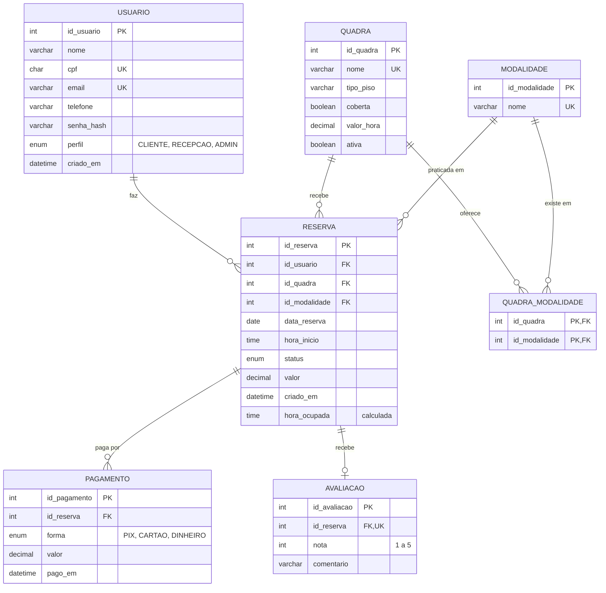

# Banco de dados do JOGGA

Este documento cobre a **Etapa 4 do PIM II** (Modelagem de Banco de Dados e NoSQL): modelo conceitual, DER, modelo lógico, normalização, modelo físico, dicionário de dados e uso de NoSQL. O código está em [`banco/jogga.sql`](../banco/jogga.sql) e foi testado no **MySQL 8.4**.

---

## 1. Modelo conceitual

Segundo Elmasri e Navathe (2018), o modelo conceitual descreve os dados em alto nível, sem depender do SGBD. A partir do processo atual da Arena Meio-Campo, em que as reservas são controladas por WhatsApp e caderno, foram identificadas estas entidades:

| Entidade | O que representa | Principais atributos |
|---|---|---|
| **Usuário** | Pessoa que usa o sistema: cliente, recepção ou administrador | nome, CPF, e-mail, telefone, senha (hash), perfil |
| **Quadra** | Espaço alugado por hora | nome, tipo de piso, coberta, valor da hora |
| **Modalidade** | Esporte praticado | nome |
| **Reserva** | Uso de uma quadra em um dia e hora, por 1 hora | data, hora, status, valor |
| **Pagamento** | Dinheiro recebido por uma reserva | forma, valor, data |
| **Avaliação** | Nota dada após o jogo | nota (1 a 5), comentário |

| Relacionamento | Cardinalidade | Leitura |
|---|---|---|
| Usuário **faz** Reserva | 1:N | um usuário faz várias reservas; cada reserva é de um usuário |
| Quadra **recebe** Reserva | 1:N | uma quadra tem várias reservas; cada reserva é de uma quadra |
| Modalidade **é praticada em** Reserva | 1:N | cada reserva tem um esporte |
| Quadra **oferece** Modalidade | N:N | a poliesportiva tem vôlei e basquete; o futebol society existe em duas quadras |
| Reserva **é paga por** Pagamento | 1:N | sinal no Pix e restante no balcão, por exemplo |
| Reserva **recebe** Avaliação | 1:0..1 | no máximo uma avaliação por reserva |

## 2. DER

Notação pé de galinha: `||` = exatamente um, `o{` = zero ou muitos, `o|` = zero ou um.

**Conceitual** (Figura 7 do trabalho escrito). Fonte editável: [`fontes/der_conceitual.svg`](fontes/der_conceitual.svg).


**Completo**, com atributos (renderizado pelo GitHub; fonte em [`fontes/der.mmd`](fontes/der.mmd)):



## 3. Modelo lógico

| Tabela | Chave primária | Chaves estrangeiras | Demais colunas |
|---|---|---|---|
| usuario | id_usuario | – | nome, cpf (único), email (único), telefone, senha_hash, perfil, criado_em |
| modalidade | id_modalidade | – | nome (único) |
| quadra | id_quadra | – | nome (único), tipo_piso, coberta, valor_hora, ativa |
| quadra_modalidade | id_quadra + id_modalidade | id_quadra → quadra; id_modalidade → modalidade | – |
| reserva | id_reserva | id_usuario → usuario; id_quadra → quadra; id_modalidade → modalidade | data_reserva, hora_inicio, status, valor, criado_em, hora_ocupada (calculada) |
| pagamento | id_pagamento | id_reserva → reserva | forma, valor, pago_em |
| avaliacao | id_avaliacao | id_reserva → reserva (única) | nota, comentario |

O relacionamento N:N entre quadra e modalidade virou a tabela associativa `quadra_modalidade`, com chave primária composta. Dinheiro usa `DECIMAL(8,2)` e não `FLOAT`, porque o `FLOAT` não representa centavos com exatidão.

## 4. Normalização

A normalização elimina repetições e as anomalias de inserção, atualização e exclusão (ELMASRI; NAVATHE, 2018). O ponto de partida é a planilha que a recepção usa hoje.

**Forma não normalizada (planilha da recepção)**

| Cliente | Telefone | Quadra | Modalidades | Data | Hora | Valor | Pagamento |
|---|---|---|---|---|---|---|---|
| Lucas Ferreira | 11 97654-0003 | Society 1 | Futebol society | 01/10 | 19h | 180 | Pix 180 |
| Bruno Almeida | 11 97654-0004 | Society 1 | Futebol society | 01/10 | 20h | 180 | Pix 90 (sinal); Cartão 90 |
| Fernanda Lima | 11 97654-0007 | Poliesportiva | Vôlei, Basquete | 05/10 | 19h | 120 | Cartão 120 |
| Lucas Ferreira | 11 97654-0003 | Society 1 | Futebol society | 08/10 | 19h | 180 | Pix 180 |

Problemas: células com listas (modalidades, pagamentos); telefone repetido em toda reserva (trocar o número exige alterar várias linhas); não dá para cadastrar uma quadra sem reserva; apagar a única reserva de um cliente apaga o contato dele; e nada impede duas linhas com a mesma quadra, data e hora.

**1FN** (valores atômicos, sem grupos repetidos): cada pagamento vira uma linha e cada par quadra–modalidade também. A reserva passa a ter a chave (quadra, data, hora), que já expressa a regra principal. O telefone continua repetido.

| Quadra | Data | Hora | Cliente | Telefone | Valor | Forma | Valor pago |
|---|---|---|---|---|---|---|---|
| Society 1 | 01/10 | 19h | Lucas Ferreira | 11 97654-0003 | 180 | Pix | 180 |
| Society 1 | 01/10 | 20h | Bruno Almeida | 11 97654-0004 | 180 | Pix | 90 |
| Society 1 | 01/10 | 20h | Bruno Almeida | 11 97654-0004 | 180 | Cartão | 90 |
| Poliesportiva | 05/10 | 19h | Fernanda Lima | 11 97654-0007 | 120 | Cartão | 120 |

**2FN** (sem dependência parcial da chave composta): o tipo de piso, a cobertura e o valor da hora dependem só da **quadra**, não da reserva inteira. Esses dados vão para a tabela `quadra`, e a reserva ganha a chave `id_reserva`. Os pagamentos passam a apontar só para `id_reserva`.

| id_quadra | nome | tipo_piso | coberta | valor_hora |
|---|---|---|---|---|
| 1 | Society 1 | grama sintética | não | 180,00 |
| 4 | Poliesportiva | poliuretano | sim | 120,00 |

**3FN** (sem dependência transitiva): o telefone depende do **cliente**, e não da reserva (id_reserva → cliente → telefone). O nome do esporte depende da **modalidade**. Os dados vão para `usuario` e `modalidade`, e a reserva guarda só as chaves:

| id_reserva | id_usuario | id_quadra | id_modalidade | data_reserva | hora_inicio | status | valor |
|---|---|---|---|---|---|---|---|
| 1 | 3 | 1 | 1 | 2026-10-01 | 19:00 | CONCLUIDA | 180,00 |
| 2 | 4 | 1 | 1 | 2026-10-01 | 20:00 | CONCLUIDA | 180,00 |
| 5 | 7 | 4 | 3 | 2026-10-05 | 19:00 | CONCLUIDA | 120,00 |
| 7 | 3 | 1 | 1 | 2026-10-08 | 19:00 | CONCLUIDA | 180,00 |

Resultado: trocar o telefone de um cliente altera uma linha só; quadras e clientes podem ser cadastrados sem reserva; apagar uma reserva não apaga o cliente. O `valor` fica na reserva porque é o preço combinado naquele dia: se a quadra for reajustada, as reservas antigas não mudam.

## 5. Modelo físico (MySQL 8)

**Regra principal: nunca duas reservas na mesma quadra, dia e hora.** Um `UNIQUE (id_quadra, data_reserva, hora_inicio)` simples não serve, porque uma reserva **cancelada** continuaria ocupando o horário. A solução é uma coluna calculada pelo próprio banco:

```sql
hora_ocupada TIME GENERATED ALWAYS AS
    (CASE WHEN status = 'CANCELADA' THEN NULL ELSE hora_inicio END) STORED,
CONSTRAINT uk_horario UNIQUE (id_quadra, data_reserva, hora_ocupada)
```

Quando a reserva é cancelada, `hora_ocupada` vira `NULL`, e o `UNIQUE` ignora valores nulos. Assim o horário volta a ficar livre.

**Outras regras garantidas pelo banco**

| Regra | Como |
|---|---|
| Horário entre 08h e 22h (cada reserva dura 1 hora) | `CONSTRAINT ck_horario CHECK (hora_inicio BETWEEN '08:00:00' AND '22:00:00')` |
| Nota de 1 a 5 | `CONSTRAINT ck_nota CHECK (nota BETWEEN 1 AND 5)` |
| Valores maiores que zero | `CHECK (valor > 0)`, `CHECK (valor_hora > 0)` |
| CPF e e-mail não se repetem | `UNIQUE` |
| Uma avaliação por reserva | `UNIQUE (id_reserva)` em avaliacao |
| Não apagar quadra, cliente ou reserva em uso | chaves estrangeiras (o padrão do MySQL é recusar a exclusão) |
| Senha nunca em texto puro | coluna `senha_hash` |

Também há índices em `reserva(data_reserva)` (agenda do dia) e `reserva(id_usuario)` (reservas de um cliente), além da view `vw_agenda`, que mostra as reservas com os nomes de quadra, esporte e cliente.

**Testes** ([`banco/jogga_testes.sql`](../banco/jogga_testes.sql)):

| Teste | Esperado | Resultado |
|---|---|---|
| Reservar a Society 1 em 22/10 às 19h (já ocupada) | erro `uk_horario` | recusado |
| Avaliação com nota 6 | erro `ck_nota` | recusado |
| Reserva às 23h | erro `ck_horario` | recusado |
| Apagar uma quadra em uso | erro de chave estrangeira | recusado |
| Reservar o horário de uma reserva cancelada | deve funcionar | aceito |

## 6. Dicionário de dados

| Tabela | Coluna | Tipo | Restrições | Descrição |
|---|---|---|---|---|
| usuario | id_usuario | `int` | PK; AUTO_INCREMENT | Identificador do usuário |
| usuario | nome | `varchar(100)` | NOT NULL | Nome completo |
| usuario | cpf | `char(11)` | UNIQUE; NOT NULL | CPF somente com dígitos |
| usuario | email | `varchar(120)` | UNIQUE; NOT NULL | E-mail, usado como login |
| usuario | telefone | `varchar(15)` | NOT NULL | Celular com DDD |
| usuario | senha_hash | `varchar(255)` | NOT NULL | Hash da senha (nunca a senha) |
| usuario | perfil | `enum('CLIENTE', 'RECEPCAO', 'ADMIN')` | NOT NULL; DEFAULT CLIENTE | CLIENTE, RECEPCAO ou ADMIN |
| usuario | criado_em | `datetime` | NOT NULL; DEFAULT CURRENT_TIMESTAMP | Data e hora do cadastro |
| modalidade | id_modalidade | `int` | PK; AUTO_INCREMENT | Identificador da modalidade |
| modalidade | nome | `varchar(40)` | UNIQUE; NOT NULL | Nome do esporte |
| quadra | id_quadra | `int` | PK; AUTO_INCREMENT | Identificador da quadra |
| quadra | nome | `varchar(40)` | UNIQUE; NOT NULL | Nome exibido (ex.: Society 1) |
| quadra | tipo_piso | `varchar(30)` | NOT NULL | Tipo de piso |
| quadra | coberta | `tinyint(1)` | NOT NULL; DEFAULT 0 | Se a quadra é coberta |
| quadra | valor_hora | `decimal(8,2)` | NOT NULL; CHECK (valor_hora > 0) | Preço da hora em reais |
| quadra | ativa | `tinyint(1)` | NOT NULL; DEFAULT 1 | Se a quadra está disponível para reservas |
| quadra_modalidade | id_quadra | `int` | PK; FK → quadra.id_quadra | Quadra |
| quadra_modalidade | id_modalidade | `int` | PK; FK → modalidade.id_modalidade | Modalidade oferecida na quadra |
| reserva | id_reserva | `int` | PK; AUTO_INCREMENT | Código da reserva |
| reserva | id_usuario | `int` | FK → usuario.id_usuario; NOT NULL | Cliente que reservou |
| reserva | id_quadra | `int` | FK → quadra.id_quadra; UNIQUE (id_quadra, data_reserva, hora_ocupada); NOT NULL | Quadra reservada |
| reserva | id_modalidade | `int` | FK → modalidade.id_modalidade; NOT NULL | Esporte jogado |
| reserva | data_reserva | `date` | UNIQUE (id_quadra, data_reserva, hora_ocupada); NOT NULL | Dia do jogo |
| reserva | hora_inicio | `time` | NOT NULL; CHECK (hora_inicio between '08:00:00' and '22:00:00') | Hora de início (08h a 22h; dura 1 hora) |
| reserva | status | `enum('CONFIRMADA', 'CANCELADA', 'CONCLUIDA', 'NO_SHOW')` | NOT NULL; DEFAULT CONFIRMADA | CONFIRMADA, CANCELADA, CONCLUIDA ou NO_SHOW |
| reserva | valor | `decimal(8,2)` | NOT NULL; CHECK (valor > 0) | Valor combinado na reserva |
| reserva | criado_em | `datetime` | NOT NULL; DEFAULT CURRENT_TIMESTAMP | Quando a reserva foi feita |
| reserva | hora_ocupada | `time` | UNIQUE (id_quadra, data_reserva, hora_ocupada); calculada (GENERATED) | Calculada pelo banco: hora_inicio, ou NULL se cancelada |
| pagamento | id_pagamento | `int` | PK; AUTO_INCREMENT | Identificador do pagamento |
| pagamento | id_reserva | `int` | FK → reserva.id_reserva; NOT NULL | Reserva paga |
| pagamento | forma | `enum('PIX', 'CARTAO', 'DINHEIRO')` | NOT NULL | PIX, CARTAO ou DINHEIRO |
| pagamento | valor | `decimal(8,2)` | NOT NULL; CHECK (valor > 0) | Valor pago |
| pagamento | pago_em | `datetime` | NOT NULL; DEFAULT CURRENT_TIMESTAMP | Data e hora do pagamento |
| avaliacao | id_avaliacao | `int` | PK; AUTO_INCREMENT | Identificador da avaliação |
| avaliacao | id_reserva | `int` | FK → reserva.id_reserva; UNIQUE; NOT NULL | Reserva avaliada (uma avaliação por reserva) |
| avaliacao | nota | `int` | NOT NULL; CHECK (nota between 1 and 5) | Nota de 1 a 5 |
| avaliacao | comentario | `varchar(300)` | – | Comentário opcional |

## 7. NoSQL

Segundo Sadalage e Fowler (2013), bancos NoSQL são adequados a dados com estrutura flexível e alto volume. No JOGGA, **reservas e pagamentos ficam no MySQL**, porque precisam das propriedades **ACID**: a reserva é gravada inteira ou não é gravada (atomicidade); as regras acima nunca são violadas (consistência); de dois pedidos ao mesmo tempo para o mesmo horário, só um é aceito (isolamento); e um pagamento confirmado não se perde (durabilidade).

O NoSQL entra como complemento (persistência poliglota):

**Redis** (chave-valor, em memória): guarda em cache os horários livres e "segura" um horário por 15 minutos enquanto o cliente paga o sinal. `NX` só grava se ninguém tiver pego antes, e `EX` faz a chave expirar sozinha.

```text
SET livres:q1:2026-10-22 '["08:00","09:00","10:00","20:00"]' EX 60   # lista resumida
SET bloqueio:q1:2026-10-22:20 "usuario:5" NX EX 900    # OK: horário segurado
SET bloqueio:q1:2026-10-22:20 "usuario:9" NX EX 900    # (nil): alguém já está pagando
DEL bloqueio:q1:2026-10-22:20                          # pagou: grava a reserva no MySQL
```

**MongoDB** (documentos JSON): avaliações com fotos e notas por critério, logs de uso e chat da partida, dados cujo formato varia de um registro para outro.

```json
{
  "id_reserva": 13,
  "quadra": "Society 1",
  "usuario": { "id": 3, "nome": "Lucas Ferreira" },
  "nota_geral": 5,
  "criterios": { "gramado": 5, "iluminacao": 4, "vestiario": 5 },
  "fotos": ["https://cdn.jogga.app/avaliacoes/13-1.jpg"],
  "comentario": "Sempre impecavel."
}
```

```javascript
db.avaliacoes.insertOne({ id_reserva: 13, quadra: "Society 1", nota_geral: 5 });
db.avaliacoes.aggregate([
  { $group: { _id: "$quadra", media: { $avg: "$nota_geral" } } },
  { $sort: { media: -1 } }
]);
```

| Dado | Onde fica | Por quê |
|---|---|---|
| Usuários, quadras, reservas, pagamentos | MySQL | ACID e regras garantidas pelo banco |
| Cache de horários e bloqueio no pagamento | Redis | rápido e com expiração automática |
| Avaliações com fotos, logs, chat | MongoDB | formato flexível e grande volume |

---

## Referências

ELMASRI, R.; NAVATHE, S. B. **Sistemas de banco de dados**. 7. ed. São Paulo: Pearson, 2018.

SADALAGE, P. J.; FOWLER, M. **NoSQL essencial**: um guia conciso para o mundo emergente da persistência poliglota. São Paulo: Novatec, 2013.
